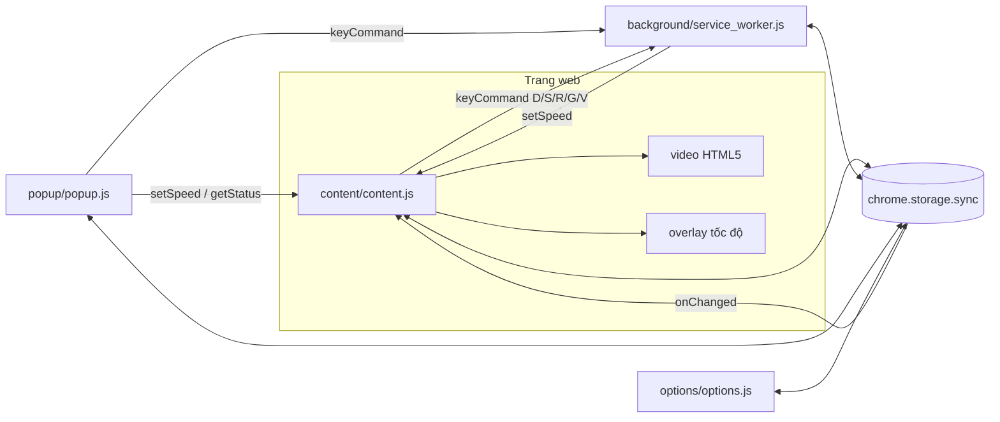

# Video Speed Controller

> Chrome extension để điều chỉnh tốc độ phát video HTML5 trên mọi trang web bằng phím tắt đơn giản và overlay hiển thị tốc độ trực tiếp trên video.


---

## Mục lục

- [Giới thiệu](#giới-thiệu)
- [Tính năng](#tính-năng)
- [Cài đặt](#cài-đặt)
- [Sử dụng](#sử-dụng)
- [Phím tắt](#phím-tắt)
- [Kiến trúc](#kiến-trúc)
- [License](#license)
- [Liên hệ](#liên-hệ)

---

## Giới thiệu

### Vấn đề

- Các trang web video thường không cho phép điều chỉnh tốc độ vượt quá 2x
- Không có phím tắt đơn giản để thay đổi tốc độ nhanh chóng khi đang xem
- Khó biết tốc độ hiện tại đang là bao nhiêu trong khi xem video

### Giải pháp

Video Speed Controller cho phép:
- Điều chỉnh tốc độ từ **0.1x đến 20x** trên mọi trang web có video HTML5
- Nhấn **một phím duy nhất** để tăng/giảm tốc độ ngay lập tức
- Hiển thị **overlay tốc độ** ngay trên góc video và cho phép kéo thả trong lúc xem

### Công nghệ

- Chrome Extension Manifest V3
- Vanilla JavaScript (không có dependency bên ngoài)
- Chrome Storage Sync API làm nguồn dữ liệu chung
- Chrome Tabs API và message passing giữa popup, service worker và content script
- HTML/CSS thuần với design token, không dùng framework UI

---

## Tính năng

### Tính năng cốt lõi

- **Điều chỉnh tốc độ**: Tăng/giảm theo bước tùy chỉnh (mặc định 0.5), hỗ trợ preset nhanh
- **Overlay trên video**: Hiển thị tốc độ hiện tại ngay góc trên trái video, có thể kéo thả
- **Phím tắt đơn**: D (tăng), S (giảm), R (reset về tốc độ mặc định), G (áp dụng yêu thích), V (ẩn/hiện overlay)
- **Tốc độ yêu thích**: Lưu và áp dụng tốc độ ưa thích nhanh (mặc định 2x)
- **Tự động áp dụng**: Áp dụng tốc độ đã lưu cho mọi video khi tải trang
- **Blacklist / Whitelist**: Kiểm soát trang nào được bật extension

### Tính năng nâng cao

- **Popup live update**: Slider và hiển thị tốc độ trong popup cập nhật ngay lập tức khi nhấn phím tắt
- **Điều chỉnh độ trong suốt**: Slider điều chỉnh opacity của overlay ngay trong popup
- **Preset bước nhảy**: Các nút preset nhanh (0.25 / 0.5 / 1.0 / 2.0) để chọn bước tăng giảm
- **Giao diện sáng/tối**: Chọn Hệ thống, Sáng hoặc Tối; mặc định theo cài đặt hệ điều hành
- **Trang cài đặt một chỗ**: Sidebar điều hướng theo nhóm, sửa cả danh sách trang trong một vùng soạn thảo, cảnh báo lỗi ngay tại ô nhập
- **Phát hiện video tự động**: Tự phát hiện và áp dụng cả với video được thêm động (SPA)
- **Kéo overlay không dừng video**: Di chuyển overlay mà video vẫn tiếp tục phát

---

## Cài đặt

**Yêu cầu**: Chrome (hoặc trình duyệt nhân Chromium) phiên bản 105 trở lên, không cần Node.js hay bất kỳ dependency nào — extension chạy trực tiếp từ mã nguồn.

### Cài đặt ở chế độ Developer (Load unpacked)

1. Clone repository:
   ```bash
   git clone https://github.com/ntd237/video_speed_controller_extension_05052026.git
   cd video_speed_controller_extension_05052026
   ```

2. Mở Chrome và truy cập:
   ```
   chrome://extensions/
   ```

3. Bật **Developer mode** (góc trên phải)

4. Nhấn **Load unpacked** và chọn thư mục dự án (thư mục chứa `manifest.json`)

5. Extension sẽ xuất hiện trong thanh công cụ Chrome

6. Kiểm tra: mở một video bất kỳ, nhấn `D` — overlay góc trên trái video phải hiện tốc độ mới. Nếu chưa thấy, mở popup và xem tốc độ hiện tại có đổi không.

### Cập nhật sau khi sửa mã nguồn

Mở `chrome://extensions/` → nhấn nút **Reload** trên card của extension, sau đó tải lại trang đang mở.

---

## Sử dụng

### Popup UI

Nhấn vào icon extension trong thanh công cụ để mở popup:

- **Thanh trượt tốc độ**: Kéo để thay đổi tốc độ (0.1 – 20x)
- **Nút − / 1x / +**: Giảm / reset / tăng tốc độ theo bước đã chọn
- **Preset bước nhảy**: Chọn nhanh bước nhảy 0.25, 0.5, 1.0, hoặc 2.0
- **Tốc độ yêu thích**: Nhập tốc độ ưa thích → nhấn **Lưu** để ghi nhớ
- **Độ trong suốt**: Kéo slider để điều chỉnh độ trong suốt của overlay
- **Toggle trang**: Bật/tắt extension cho domain hiện tại
- **Nút Mở cài đặt**: Mở trang Options để cấu hình nâng cao

### Trang Options

Truy cập tại `chrome://extensions/` → nhấn **Details** → **Extension options**, hoặc nhấn nút **Mở cài đặt** trong popup. Trang có sidebar điều hướng theo nhóm cài đặt và thanh lưu cố định ở đầu trang:

- **Chế độ và trang web**: chọn **Danh sách chặn** hoặc **Danh sách cho phép**, sửa toàn bộ danh sách trong một vùng soạn thảo (mỗi dòng một trang), lỗi nhập liệu hiển thị ngay dưới danh sách
- **Tốc độ**: bước nhảy (kèm preset), tốc độ mặc định, tốc độ yêu thích
- **Hiển thị**: bật/tắt overlay, độ trong suốt, giao diện **Hệ thống / Sáng / Tối**, tự động áp dụng tốc độ
- **Phím tắt**: danh sách phím tắt đang dùng

Thay đổi chưa lưu được báo bằng chấm trạng thái ở thanh trên; nhấn **Lưu cài đặt** (hoặc `Ctrl/Cmd + S`) để ghi vào `chrome.storage.sync`.

---

## Phím tắt

Các phím tắt hoạt động khi **trang web đang có focus** (không phải khi đang gõ vào ô input):

| Phím | Chức năng |
|------|-----------|
| `D` | Tăng tốc độ theo bước |
| `S` | Giảm tốc độ theo bước |
| `R` | Reset về tốc độ mặc định |
| `G` | Áp dụng tốc độ yêu thích |
| `V` | Ẩn / hiện overlay tốc độ |

> Các phím tắt cũng hoạt động **bên trong popup** khi popup đang mở.
>
> Đây là phím do extension tự xử lý, không phải lệnh cấp browser, nên không cấu hình trong `chrome://extensions/shortcuts`.

---

## Kiến trúc



- `chrome.storage.sync` là nguồn sự thật duy nhất; popup và trang cài đặt chỉ đọc/ghi storage, không giữ bản sao lâu dài.
- Phím tắt trong trang hoặc trong popup gửi `keyCommand` cho service worker; service worker tính tốc độ mới, gửi `setSpeed` cho tab rồi ghi storage.
- Content script áp tốc độ cho mọi video và cập nhật overlay, đồng thời lắng nghe `storage.onChanged` để phản ứng với thay đổi từ popup hoặc phím tắt.
- Trong cross-origin iframe, content script đọc cài đặt qua message `getSettings` gửi service worker, với timeout `settingsRequestTimeoutMs`.

---

## License

Dự án này được phát hành dưới giấy phép **CC BY-NC-ND 4.0** (Creative Commons Attribution-NonCommercial-NoDerivatives 4.0):

- **Được phép**: Tự do sao chép và chia sẻ với điều kiện ghi rõ nguồn
- **Không được phép**: Chỉnh sửa, remix hoặc phát triển dựa trên mã nguồn
- **Không được phép**: Sử dụng cho mục đích thương mại

Xem toàn bộ nội dung tại: [LICENSE](LICENSE)

---

## Liên hệ

- **Tác giả**: ntd237
- **Email**: ntd237.work@gmail.com
- **GitHub**: [https://github.com/ntd237](https://github.com/ntd237)
