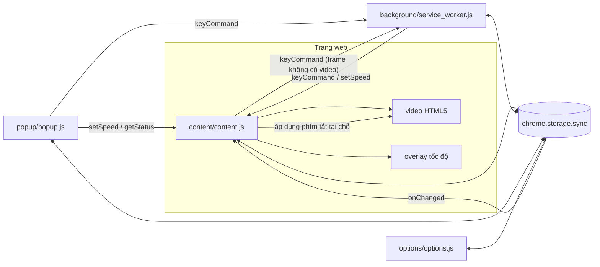

# Video Speed Controller

> Chrome extension để điều chỉnh tốc độ phát video HTML5 trên mọi trang web bằng phím tắt đơn giản và overlay hiển thị tốc độ trực tiếp trên video.


---

## Mục lục

- [Giới thiệu](#giới-thiệu)
- [Tính năng](#tính-năng)
- [Cài đặt](#cài-đặt)
- [Phím tắt](#phím-tắt)
- [Kiến trúc](#kiến-trúc)
- [License](#license)
- [Liên hệ](#liên-hệ)

---

## Giới thiệu

### Vấn đề

- Các trang web video thường không cho phép điều chỉnh tốc độ vượt quá 2x
- Không có phím tắt đơn giản để thay đổi tốc độ nhanh chóng khi đang xem
- Khó biết tốc độ hiện tại đang là bao nhiêu trong khi xem video

### Giải pháp

Video Speed Controller cho phép:
- Điều chỉnh tốc độ từ **0.1x đến 20x** trên mọi trang web có video HTML5
- Nhấn **một phím duy nhất** để tăng/giảm tốc độ ngay lập tức
- Hiển thị **overlay tốc độ** ngay trên góc video và cho phép kéo thả trong lúc xem

---

## Tính năng

### Tính năng cốt lõi

- **Điều chỉnh tốc độ**: Tăng/giảm theo bước tùy chỉnh (mặc định 0.5), hỗ trợ preset nhanh
- **Overlay trên video**: Hiển thị tốc độ hiện tại ngay góc trên trái video, có thể kéo thả
- **Phím tắt đơn**: D (tăng), S (giảm), R (reset về tốc độ mặc định), G (áp dụng yêu thích), V (ẩn/hiện overlay)
- **Tốc độ yêu thích**: Lưu và áp dụng tốc độ ưa thích nhanh (mặc định 2x)
- **Blacklist / Whitelist**: Kiểm soát trang nào được bật extension

### Tính năng nâng cao

- **Điều chỉnh độ trong suốt**: Slider điều chỉnh opacity của overlay ngay trong popup
- **Preset bước nhảy**: Các nút preset nhanh (0.25 / 0.5 / 1.0 / 2.0) để chọn bước tăng giảm
- **Giao diện sáng/tối**: Chọn Hệ thống, Sáng hoặc Tối; mặc định theo cài đặt hệ điều hành
- **Phát hiện video tự động**: Tự phát hiện và áp dụng cả với video được thêm động (SPA)
- **Kéo overlay không dừng video**: Di chuyển overlay mà video vẫn tiếp tục phát

---

## Cài đặt

**Yêu cầu**: Chrome (hoặc trình duyệt nhân Chromium) phiên bản 105 trở lên, không cần Node.js hay bất kỳ dependency nào — extension chạy trực tiếp từ mã nguồn.

### Cài đặt ở chế độ Developer (Load unpacked)

1. Clone repository:
   ```bash
   git clone https://github.com/ntd237/video_speed_controller_extension_05052026.git
   cd video_speed_controller_extension_05052026
   ```

2. Mở Chrome và truy cập:
   ```
   chrome://extensions/
   ```

3. Bật **Developer mode** (góc trên phải)

4. Nhấn **Load unpacked** và chọn thư mục dự án (thư mục chứa `manifest.json`)

5. Extension sẽ xuất hiện trong thanh công cụ Chrome

6. Kiểm tra: mở một video bất kỳ, nhấn `D` — overlay góc trên trái video phải hiện tốc độ mới. Nếu chưa thấy, mở popup và xem tốc độ hiện tại có đổi không.

### Cập nhật sau khi sửa mã nguồn

Mở `chrome://extensions/` → nhấn nút **Reload** trên card của extension, sau đó tải lại trang đang mở.

---

## Phím tắt

Các phím tắt hoạt động khi **trang web đang có focus** (không phải khi đang gõ vào ô input):

| Phím | Chức năng |
|------|-----------|
| `D` | Tăng tốc độ theo bước |
| `S` | Giảm tốc độ theo bước |
| `R` | Reset về tốc độ mặc định |
| `G` | Áp dụng tốc độ yêu thích |
| `V` | Ẩn / hiện overlay tốc độ |

---

## Kiến trúc



---

## License

Dự án này được phát hành dưới giấy phép **CC BY-NC-ND 4.0** (Creative Commons Attribution-NonCommercial-NoDerivatives 4.0):

- **Được phép**: Tự do sao chép và chia sẻ với điều kiện ghi rõ nguồn
- **Không được phép**: Chỉnh sửa, remix hoặc phát triển dựa trên mã nguồn
- **Không được phép**: Sử dụng cho mục đích thương mại

Xem toàn bộ nội dung tại: [LICENSE](LICENSE)

---

## Liên hệ

- **Tác giả**: ntd237
- **Email**: ntd237.work@gmail.com
- **GitHub**: [https://github.com/ntd237](https://github.com/ntd237)
